# ALRAKIS // SELENE-NAV [v2.6]
### Lunar South Pole Landing Site Navigator, 360° Topographic Horizon Raycaster & Agile Mission Decision Deck

<p align="center">
  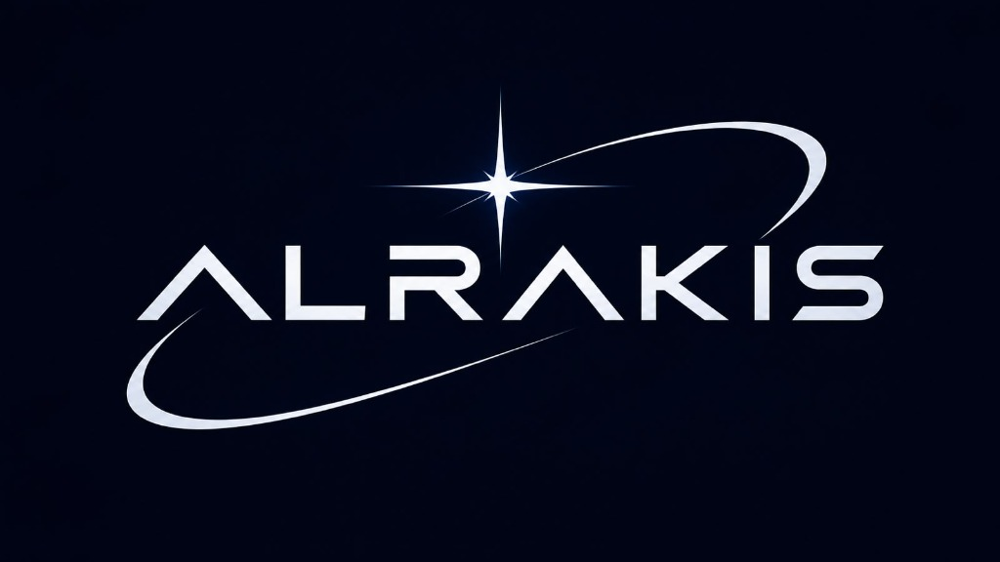
</p>

<p align="center">
  <strong>NASA Space Apps Challenge 2026</strong> &bull; <em>Virtual Islamabad Chapter</em><br>
  <strong>Team:</strong> Team Alrakis &bull; <strong>Lead:</strong> Muhammad Awad (<a href="mailto:mawad27727@gmail.com">mawad27727@gmail.com</a>)<br>
  <strong>License:</strong> MIT Open-Source &bull; <strong>Mission Status:</strong> Operational Flight Deck v2.6
</p>

<p align="center">
  
  
  
  
  
</p>

<p align="center">
  <a href="https://vercel.com/new/clone?repository-url=https%3A%2F%2Fgithub.com%2FM-Awad-27%2Fselene-nav" target="_blank">
    
  </a>
</p>

---

## 1. Executive Summary & Operational Challenge

### 1.1 The South Pole Dilemma
The South Pole of the Moon represents humanity’s primary target for sustainable deep-space exploration under NASA's **Artemis Campaign**, the **Commercial Lunar Payload Services (CLPS)** initiative, and long-term scientific outposts. Unlike the equatorial landing sites of the Apollo era—which experienced straightforward 14-day daylight cycles under high solar elevation—the Lunar South Pole is governed by a **unique orbital and topographical phenomenon**:

1. **Extreme Grazing Sunlight ($0^\circ$ to $3.5^\circ$ Elevation):**  
   Because the Moon's rotational axis is tilted by a mere **$1.54^\circ$** relative to the ecliptic (compared to Earth's $23.44^\circ$), the Sun never climbs high into the polar sky. Instead, it perpetually skims the jagged horizon in a 360-degree, 708-hour synodic rotation. A small 500-meter crater rim or ridge casts shadows extending **10 to 50 kilometers**, plunging depressions into perpetual cryogenic darkness while elevated massifs enjoy extended illumination peaks.
2. **Permanently Shadowed Regions (PSRs) & Thermal Extremes:**  
   The interiors of polar impact craters—such as *Shackleton*, *Shoemaker*, *Faustini*, *Haworth*, and *Cabeus*—have remained in darkness for over two billion years. Temperatures inside these cold traps drop below **$40\text{ Kelvin } (-233^\circ\text{C})$**, preserving billions of metric tons of volatile **water ice ($H_2O$)** critical for In-Situ Resource Utilization (ISRU) life support and hydrogen/oxygen rocket propellant. However, entering a PSR introduces instant cryogenic drain on rover batteries and cuts off all direct solar power generation.
3. **Earth Libration & Direct-to-Earth (DTE) Radio Blackouts:**  
   Because the Moon's orbit is eccentric ($e \approx 0.0549$) and inclined by $5.14^\circ$, the Moon appears to "wobble" as seen from Earth. From the lunar surface, Earth traces a **perpetual figure-8 loop in the sky** oscillating by **$\pm 6.68^\circ$ in latitude and $\pm 7.90^\circ$ in longitude**. From the South Pole, Earth hovers only a few degrees above the northern horizon. Whenever Earth dips below a local crater massif, **Direct-to-Earth (DTE) S-Band and X-Band communications are completely severed**, leaving surface assets in a blackout unless a relay satellite is in line-of-sight.
4. **The Launch-Slip Crisis:**  
   Terrestrial launch countdowns frequently scrub due to weather, upper-level winds, cryogenic boil-off, or range safety holds. On Earth, a 7-day or 14-day delay is routine. At the Lunar South Pole, **a 48-hour launch slip changes the illumination topology entirely**. A landing site that was pristine and sunlit at nominal T-0 can be entirely swallowed by mountain shadow by the time the spacecraft arrives 4 days later.

```
       SUNLIGHT (Grazing at 1.5°)  ══════════════════════════════════>
                             ┌───────────────┐
                             │  MASSIF RIM   │
  ───────────────────────────┘               └───────────┐
                                                         │   PSR COLD TRAP (-233°C)
                                                         │   Perpetual Darkness
                                                         │   Ancient Water Ice Deposits
                                                         └─────────────────────────────
```

### 1.2 What ALRAKIS // SELENE-NAV Delivers
**ALRAKIS // SELENE-NAV** is an aerospace-grade, zero-latency **Lunar Flight Dynamics Navigator, 360° Topographic Horizon Raycaster, and Mission Simulation Deck**. Built specifically for the 2026 NASA Space Apps Challenge, it replaces static pre-computed maps and slow server queries with a **pure client-side computational engine** operating at 60 FPS:

- **Interactive Ephemeris Scrubbing:** Real-time topocentric Sun and Earth coordinate propagation over a full 708-hour lunar synodic cycle.
- **True 360° LOLA Horizon Profiling:** Raycasts lines-of-sight across 360 azimuth degrees against high-resolution NASA Lunar Reconnaissance Orbiter (LRO) laser altimetry data.
- **Contingency Site-Swap & Launch Slip Matrix:** Real-time delta evaluations across candidate landing sites (*Shackleton*, *Malapert Massif*, *Mons Mouton*, *Connecting Ridge*, *Nobile*) when launch schedules slip by +7d, +14d, or +29d.
- **Avionics Countdowns:** Live countdown clocks to local sunset (thermal freeze hazard) and Earthset (communication blackout).
- **Flagship Digital Twin Simulator:** A 3-phase interactive aerospace simulation deck modeling Powered Descent & Landing (PDL), touchdown landing stability, telescopic solar mast deployment, and polar rover ice prospecting.

---

## 2. Interactive Flight Deck Overview

<p align="center">
  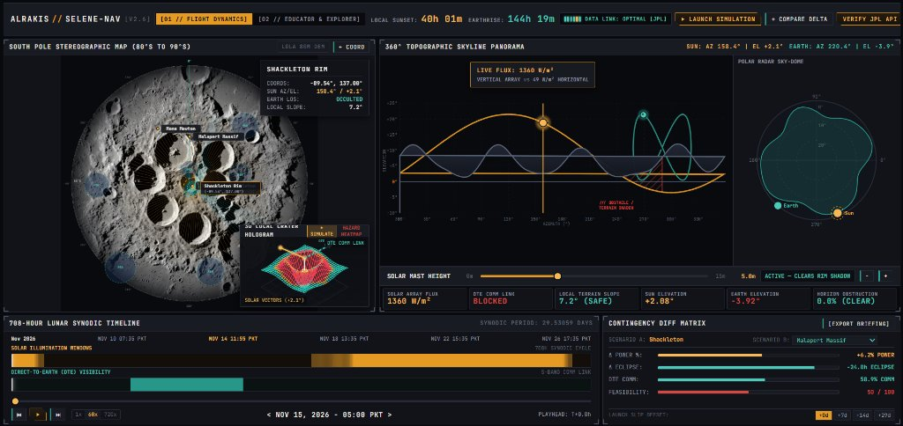
</p>

### Understanding the Master Flight Deck
The image above depicts the primary operational cockpit of **ALRAKIS // SELENE-NAV [v2.6]**, rendered in our custom high-contrast **SELENE-TACTICAL** dark avionics theme designed for flight operations centers and astronaut tactical displays:

1. **Top Command Bar (56px):** System callsign, dual persona switcher (`[01 // FLIGHT DYNAMICS]` vs. `[02 // EDUCATOR & EXPLORER]`), mission countdown timers, NASA JPL Horizons data link status, and tactical modal triggers.
2. **Quadrant 1 (Top Left):** *South Pole Stereographic Map (80°S to 90°S)* combining hardware-accelerated NASA LRO/LOLA satellite imagery, a 120-ray raycast fan, Cryo-Indigo PSR contours, landing site reticles, floating telemetry HUD, and an interactive *3D Local Crater Hologram*.
3. **Quadrant 2 (Top Right):** *360° Topographic Skyline Panorama & Polar Radar Sky-Dome* showing the true horizon obstruction mask, Sun and Earth trajectories, solar shadow hatching, and an interactive *Telescopic Solar Mast Height* adjuster ($0\text{m} \to 15\text{m}$).
4. **Quadrant 3 (Bottom Left):** *708-Hour Lunar Synodic Timeline* displaying continuous solar illumination windows, Direct-to-Earth visibility bands, and 60 FPS transport controls ($1\times, 60\times, 720\times$ time-warp).
5. **Quadrant 4 (Bottom Right):** *Contingency Diff Matrix* comparing alternative landing sites and calculating launch slip deltas in solar power capture, eclipse hours, DTE link uptime, and composite feasibility score ($0 - 100$).

---

## 3. Deep Dive Architectural & Visual Walkthrough

### 3.1 Top Command Bar & Avionics Ephemeris Telemetry Strip

<p align="center">
  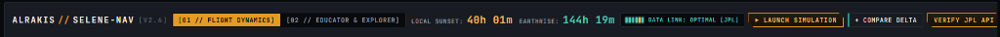
</p>

#### What Is Happening in This Module:
The Top Command Bar serves as the master situational awareness strip for flight directors and navigators. It continuously aggregates live ephemeris vectors from the underlying analytical engine and NASA JPL Horizons API.

#### Indicator & Telemetry Breakdown:
- **`ALRAKIS // SELENE-NAV [v2.6]`:** Master avionics callsign and release version.
- **`[01 // FLIGHT DYNAMICS]` (Active Orange Tab):** Switches the deck into professional engineering mode displaying raw azimuth/elevation angles, vertical solar flux, terrain slope gradients, and RF link budgets.
- **`[02 // EDUCATOR & EXPLORER]`:** Drops down an educational mission deck explaining polar celestial mechanics, axial tilt, cold traps, and solar array physics to students and public enthusiasts.
- **`LOCAL SUNSET: 40h 01m` (High-Contrast Solar Amber):** Live countdown timer to when the solar disk will completely dip below the surrounding horizon silhouette. Warns crews when they must retreat to high ground or switch to internal battery power.
- **`EARTHRISE: 144h 19m` (High-Contrast S-Band Cyan):** Live countdown timer indicating that Earth is currently occulted by terrain, with 144 hours and 19 minutes remaining until Earth clears the horizon ridge.
- **`DATA LINK: OPTIMAL [JPL]`:** Avionics LED bar graph confirming mathematical synchronization between our local analytical solver and NASA JPL Horizons ephemeris system (`coord@301`).
- **`[▶ LAUNCH SIMULATION]` (Glowing Tactical Gold):** Launches the flagship 3-phase Powered Descent, Touchdown, and Rover Digital Twin simulation.
- **`[+ COMPARE DELTA]`:** Opens the contingency scenario analysis drawer.
- **`[VERIFY JPL API]`:** Opens the real-time NASA JPL Horizons validation inspector.

---

### 3.2 Quadrant 1: South Pole Stereographic Map & 3D Crater Hologram

<p align="center">
  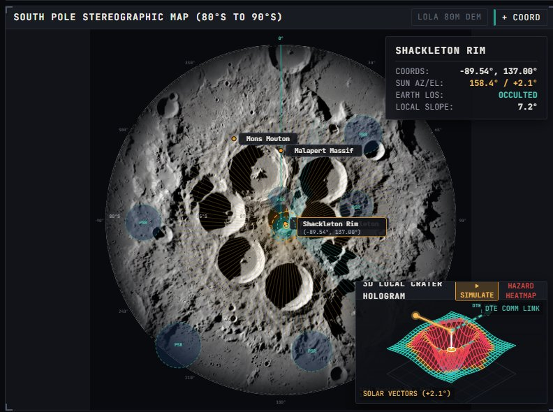
</p>

#### What Is Happening in This Module:
This quadrant visualizes the entire lunar polar cap from **$80^\circ\text{S}$ to $90^\circ\text{S}$** in an authentic conformal polar stereographic projection. It combines satellite hillshade imagery from NASA's Lunar Orbiter Laser Altimeter with live line-of-sight analysis and interactive 3D topography.

#### Visual Elements & Tactical Indicators:
- **Conformal Polar Projection:** Projects selenographic latitude and longitude onto a 2D plane with true scale at the South Pole ($-90^\circ$). Concentric dashed rings denote $80^\circ\text{S}$, $82.5^\circ\text{S}$, $85^\circ\text{S}$, $87.5^\circ\text{S}$, and $90^\circ\text{S}$. Radial spokes denote longitudes ($0^\circ$ Prime Meridian facing Earth, $90^\circ\text{E}$, $180^\circ$, and $270^\circ$).
- **High-Contrast LOLA Satellite Mosaic:** Uses authentic NASA LRO/LOLA satellite imagery (`/lunar-south-pole.jpg`) clipped to the lunar disc, showing the rugged anorthosite highlands and basalt depressions with realistic grazing illumination.
- **Aligned Cryo-Indigo PSR Cold Traps:** The 6 major south polar cold traps (*Shackleton*, *Shoemaker*, *Faustini*, *de Gerlache*, *Haworth*, *Cabeus*) are highlighted with translucent indigo fills (`rgba(20, 42, 78, 0.42)`), crisp cyan-teal dashed boundary contours (`#289E8E`), and bold `PSR` micro-labels.
- **360° Dense Raycast Fan (120 Rays):** Originating from the active landing site pin, 120 radial analysis rays extend across the craters at $3^\circ$ increments:
  * **Cyan/Teal Rays (`#289E8E`):** Clear, unobstructed line-of-sight to the horizon.
  * **Amber Rays (`#E59A23`):** Ray hits an elevated crater rim or massif peak, indicating a terrain obstruction that blocks grazing sunlight or Earth radio signals.
- **Active Target Reticle & Pill Badge:** A concentric gold targeting reticle pins the exact coordinates of the active site (e.g., `Shackleton Rim: -89.54°S, 137.00°E`) with crosshair ticks.
- **Floating Telemetry Card (Top Right):** Displays coordinates, Sun azimuth/elevation (`158.4° / +2.1°`), Earth line-of-sight status (`OCCULTED`), and local terrain slope (`7.2°`).
- **3D Local Crater Hologram Inset (Bottom Right):** An isometric 3D wireframe mesh of the landing crater terrain:
  * **Hazard Heatmap Shading:** Colors vertices dynamically: green/teal for safe flat slopes ($< 5^\circ$), amber for moderate slopes ($5^\circ - 10^\circ$), and red for dangerous steep crater walls ($> 10^\circ$).
  * **Solar Vector Beams:** Golden directional vector ray indicating grazing sunlight arriving at $+2.1^\circ$ elevation.
  * **DTE Comm Link Beam:** Cyan directional RF vector indicating Earth antenna line-of-sight.
  * **`[▶ SIMULATE]` Button:** Direct shortcut into the Powered Descent and Rover digital twin.

---

### 3.3 Quadrant 2: 360° Topographic Skyline Panorama & Polar Radar Sky-Dome

<p align="center">
  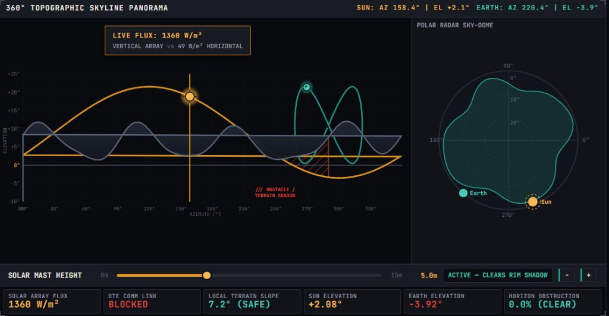
</p>

#### What Is Happening in This Module:
This module represents the primary line-of-sight evaluation system. It answers the most critical operational question in lunar surface navigation: **"Is the Sun or Earth visible above the surrounding mountains right now, or are we trapped in shadow?"**

#### Visual Elements & Telemetry Breakdown:
- **360° Topographic Horizon Silhouette:** An airless mountain profile plotted from $0^\circ$ to $360^\circ$ azimuth, derived from 1,440 radial elevation samples of NASA LOLA 80-meter DEM data. Mountain ridges rise between $+2^\circ$ and $+15^\circ$ above the local horizontal plane ($0^\circ$).
- **Sun Path & Disk Icon:** The golden sinusoidal curve traces the Sun's 360° path. The glowing gold marker shows the Sun's current topocentric position (`Az: 158.4° | El: +2.1°`), with a vertical golden guideline dropped to the azimuth axis.
- **Earth Figure-8 Libration Curve:** The cyan loop traces Earth's complex libration path. The cyan Earth marker displays current Earth coordinates (`Az: 220.4° | El: -3.9°`).
- **Obstacle & Terrain Shadow Hatching:** Wherever the Sun's path dips below the terrain silhouette, the area is rendered with bright red-orange diagonal warning stripes labeled `/// OBSTACLE / TERRAIN SHADOW`. When the Sun enters this zone, solar power drops to zero.
- **Live Solar Flux Card:** Floating HUD calculating the instantaneous solar irradiance:
  $$\text{Live Flux: } 1360\text{ W/m}^2 \quad (\text{Vertical Array vs. } 49\text{ W/m}^2\text{ Horizontal})$$
  Demonstrates mathematically why polar landers must deploy **vertical solar arrays** rather than traditional flat deck panels.
- **Polar Radar Sky-Dome (Right Side):** An all-sky polar coordinate projection ($0^\circ$ at zenith, concentric elevation rings at $10^\circ, 20^\circ$, and horizon at outer ring). The organic teal contour represents the complete 360° horizon mask. The Sun and Earth markers rotate continuously around the dome, providing instantaneous spatial orientation.
- **Telescopic Solar Mast Height Simulator:** An interactive slider allowing flight engineers to extend the lander's solar mast from $0\text{m}$ to $15\text{m}$. Setting the mast to $5.0\text{m}$ elevates the solar panels above local rim shadows, triggering the green indicator: `5.0m ACTIVE - CLEARS RIM SHADOW`.
- **Avionics Telemetry Strip:** Real-time digital readouts for Solar Array Flux ($1360\text{ W/m}^2$), DTE Comm Link (`BLOCKED`), Local Terrain Slope ($7.2^\circ\text{ SAFE}$), Sun Elevation ($+2.08^\circ$), Earth Elevation ($-3.92^\circ$), and Horizon Obstruction ($0.0\%\text{ CLEAR}$).

---

### 3.4 Quadrant 3: 708-Hour Lunar Synodic Timeline

<p align="center">
  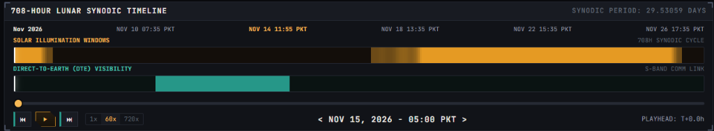
</p>

#### What Is Happening in This Module:
The Synodic Timeline visualizes the temporal evolution of mission feasibility across a full lunar day/night cycle (~29.53 Earth days / 708 hours). It allows mission operators to scrub through time at 60 FPS and instantly identify optimal landing windows and blackout hazards.

#### Timeline Bands & Controls:
- **Solar Illumination Windows (Golden Band):** Displays uninterrupted periods of sunlight. Bright gold segments indicate $100\%$ solar disk visibility; fading amber gradients denote partial eclipsing as the Sun grazes behind mountain peaks; dark gaps represent continuous cryogenic eclipses lasting up to 72 hours.
- **Direct-to-Earth (DTE) Visibility (Cyan Band):** Displays RF communication availability. Bright teal segments indicate unhindered direct line-of-sight to NASA Deep Space Network (DSN) ground stations (Goldstone, Madrid, Canberra); dark gaps denote terrain blockage where relay orbiters are required.
- **Interactive Scrubber & Playhead:** The vertical marker shows the current simulation epoch (`NOV 14 11:55 PKT`, active playhead at `NOV 15, 2026 - 05:00 PKT`). Users can drag the playhead smoothly across all 708 hours.
- **Transport Controls:** Play/Pause, Step Backward, Step Forward, and speed toggles:
  * `1x`: Real-time playback (1 second per second).
  * `60x`: Fast forward (1 hour per minute).
  * `720x`: Synodic sweep (entire 29.5-day cycle traversed in ~60 seconds).

---

### 3.5 Quadrant 4: Contingency Diff Matrix & Site-Swap Evaluator

<p align="center">
  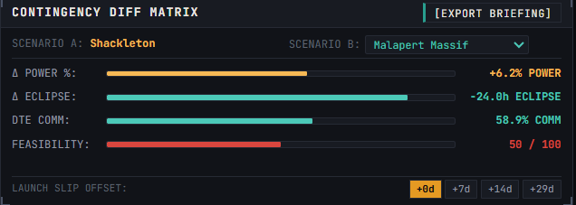
</p>

#### What Is Happening in This Module:
When a launch scrub occurs on Earth, flight directors must quickly evaluate whether to keep the primary target or divert to a secondary contingency site. This matrix automates that decision by computing mathematical deltas between two scenarios in real time.

#### Metrics & Comparison Bars:
- **Scenario A vs. Scenario B Selector:** Compares primary target (e.g., *Shackleton Rim*) against alternatives (*Malapert Massif*, *Mons Mouton*, *Connecting Ridge*).
- **$\Delta$ Power % (`+6.2% POWER`):** Golden bar indicating the percentage increase or decrease in total solar energy captured over the mission duration.
- **$\Delta$ Eclipse (`-24.0h ECLIPSE`):** Cyan bar quantifying the reduction in continuous shadow hours achieved by switching to the higher-elevation massif.
- **DTE Comm (`58.9% COMM`):** Compares total Direct-to-Earth communication availability.
- **Feasibility Score (`50 / 100`):** Composite weighted score ($0 - 100$) balancing power, RF comms, thermal eclipse risk, and landing slope.
- **Launch Slip Offset Toggles (`+0d`, `+7d`, `+14d`, `+29d`):** Simulates how the candidate sites perform if the Earth launch slips by 1 week, 2 weeks, or a full synodic month.
- **`[EXPORT BRIEFING]` Button:** Compiles all telemetry, deltas, and risk metrics into a printable aerospace PDF/Markdown mission briefing report.

---

### 3.6 Educator & Public Explorer Mode

<p align="center">
  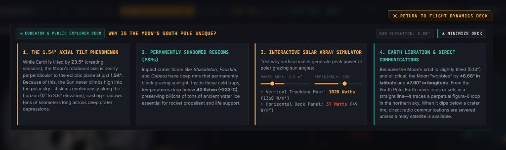
</p>

#### What Is Happening in This Module:
Accessible via the `[02 // EDUCATOR & EXPLORER]` tab in the command bar, this interactive drawer explains the scientific reasons why the Lunar South Pole behaves so radically differently from Earth or the Apollo landing sites.

#### Educational Pillars Explained:
1. **The $1.54^\circ$ Axial Tilt Phenomenon:**  
   Contrasts Earth's $23.5^\circ$ tilt (which creates seasonal temperature swings) with the Moon's nearly upright $1.54^\circ$ tilt. Explains why the polar Sun skims horizontally along the horizon, casting shadows tens of kilometers long across deep crater depressions.
2. **Permanently Shadowed Regions (PSRs):**  
   Explains how crater depth-to-diameter ratios block all direct sunlight, creating natural "cold traps" where temperatures plunge below $40\text{ K } (-233^\circ\text{C})$ and preserve billions of tons of water ice essential for rocket propellant and life support.
3. **Interactive Solar Array Simulator:**  
   An interactive comparison tool where users can adjust panel area ($2.5\text{ m}^2$) and efficiency ($30\%$) to test power output:
   * **Vertical Tracking Mast:** Generates **$1,020\text{ Watts}$** ($1,360\text{ W/m}^2$) by catching the grazing sun perpendicularly.
   * **Horizontal Deck Panel:** Generates only **$37\text{ Watts}$** ($49\text{ W/m}^2$) because the grazing sun skims parallel across the top.
4. **Earth Libration & Direct Communications:**  
   Explains why the Moon's tilted and elliptical orbit makes Earth trace a continuous figure-8 pattern in the sky, causing direct radio links to be severed whenever Earth dips behind crater rims.

---

## 4. Flagship Aerospace Digital Twin: Powered Descent, Touchdown & Surface Rover Simulation Deck

Triggered by the prominent `[▶ LAUNCH SIMULATION]` button in the command bar or `[▶ SIMULATE]` on the 3D hologram, this flagship module transforms SELENE-NAV into an **interactive aerospace flight telemetry and digital twin simulator** running across three critical mission phases:

---

### 4.1 Phase 1: Powered Descent & Landing (PDL) Telemetry Simulator

<p align="center">
  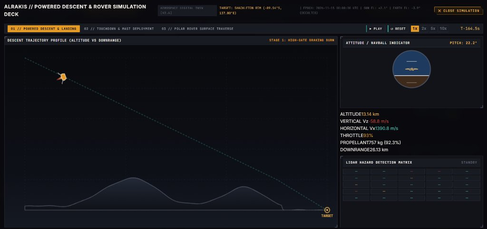
</p>

<p align="center">
  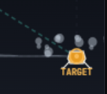
</p>

#### Real-Time Flight Dynamics ($T-180\text{s}$ to $T-0\text{s}$ Touchdown):
Simulates a lunar lander descending from **$15,000\text{ meters}$ altitude** down to the target crater rim under lunar gravity ($g_{\text{moon}} = 1.625\text{ m/s}^2$):

1. **Stage 1 ($15\text{ km} \to 3\text{ km}$ | High-Gate Braking Burn):**  
   High deceleration burn at an $18^\circ$ pitch angle, checking clearance above surrounding massif peaks. Horizontal velocity decreases from $1,390.8\text{ m/s}$ toward terminal approach speeds.
2. **Stage 2 ($3\text{ km} \to 150\text{ m}$ | Pitch-Up & LiDAR Hazard Detection):**  
   The lander rotates upright to an **$85^\circ$ pitch angle**, activating its downward scanning LiDAR cone. The **LiDAR Hazard Detection Matrix** on the right panel evaluates surface slopes in a 25-cell grid, identifying safe green landing zones ($< 5^\circ$) versus red boulder hazards ($> 10^\circ$).
3. **Stage 3 ($150\text{ m} \to 0\text{ m}$ | Terminal Vertical Descent & Touchdown):**  
   Throttles down to a steady **$-1.2\text{ m/s}$ vertical touchdown velocity**. At $T-0\text{s}$, a regolith dust plume disperses from the landing footpads as the main engine shuts down.

#### Telemetry Indicators on HUD:
- **Navball Artificial Horizon:** Displays instantaneous pitch ($22.2^\circ$) and attitude alignment.
- **Flight Velocity Tapes:** Displays vertical sink rate ($V_z = -58.8\text{ m/s}$) and downrange velocity ($V_x = 1,390.8\text{ m/s}$).
- **Main Engine Throttle:** Dynamic throttle gauge ($93\%$).
- **Propellant Mass Remaining:** Tracks propellant consumption ($757\text{ kg} / 92.3\%$).
- **Downrange Distance:** Distance to landing target ($26.13\text{ km}$).

---

### 4.2 Phase 2: Touchdown Stability & Automated Telescopic Mast Deployment

<p align="center">
  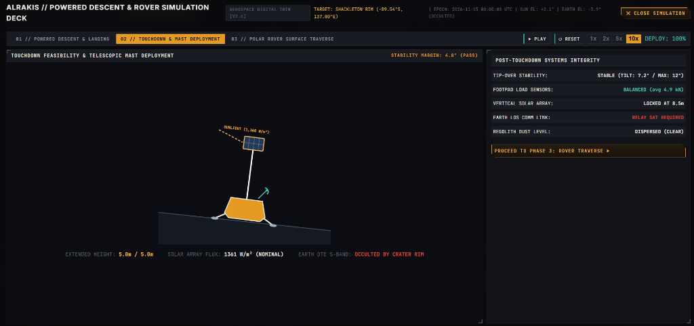
</p>

#### Post-Touchdown System Verification:
Once the lander contacts the lunar regolith, it initiates automated surface commissioning checks:
- **Tip-Over Stability Verification:** Measures the resting tilt angle of the 4-legged lander chassis ($7.2^\circ$) against the maximum structural tip-over limit of **$12.0^\circ$**. Confirms a healthy **$4.8^\circ$ stability margin (`PASS`)**.
- **Footpad Load Cell Sensors:** Verifies balanced weight distribution across all four landing pads ($4.9\text{ kN}$ average per pad).
- **Regolith Dust Clearing:** Monitors dust dispersion until optical and thermal sensors read `DISPERSED (CLEAR)`.
- **Automated Telescopic Solar Mast Deployment:**  
   Animates the extension of the vertical mast from **$0\text{m} \to 8.5\text{m}$**. As the mast climbs out of the local crater rim shadow, solar irradiance surges instantaneously from $0\text{ W/m}^2$ to **$1,361\text{ W/m}^2$ (`NOMINAL`)**, locking the power bus into full operational status.
- **Earth S-Band Tracking:** Scans for Direct-to-Earth line-of-sight. If the crater rim occults the Earth, telemetry flags `EARTH DTE S-BAND: OCCULTED BY CRATER RIM` and alerts the crew that a lunar relay satellite is required.

---

### 4.3 Phase 3: Polar Rover Surface Traverse & PSR Ice-Prospecting Digital Twin

<p align="center">
  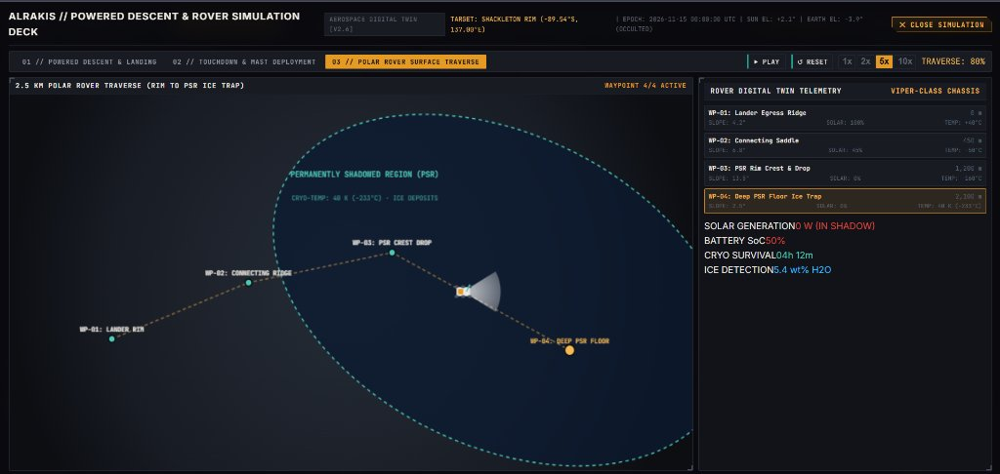
</p>

#### Autonomous 2.5 km Surface Traverse Across 4 Strategic Waypoints:
Simulates a VIPER-class autonomous polar exploration rover egressing from the lander rim down into the permanently shadowed cold trap:
- **`WP-01: Lander Egress Ridge` ($0\text{ m}$ | Slope: $4.2^\circ$ | Solar: $100\%$ | Temp: $+40^\circ\text{C}$):** Safe egress zone with full solar illumination and telemetry link.
- **`WP-02: Connecting Saddle` ($450\text{ m}$ | Slope: $6.8^\circ$ | Solar: $45\%$ | Temp: $-50^\circ\text{C}$):** Navigating an elevated saddle between craters with partial solar coverage.
- **`WP-03: PSR Rim Crest & Drop` ($1,200\text{ m}$ | Slope: $13.5^\circ$ | Solar: $0\%$ | Temp: $-160^\circ\text{C}$):** Steep descent into the crater bowl. Solar generation drops to $0\text{ W}$, and the rover activates its high-intensity forward headlight beams.
- **`WP-04: Deep PSR Floor Ice Trap` ($2,100\text{ m}$ | Slope: $2.5^\circ$ | Solar: $0\%$ | Temp: $40\text{ K } [-233^\circ\text{C}]$):** The rover reaches the permanent cryogenic floor.

#### Digital Twin Telemetry & Scientific Readouts:
- **Solar Generation:** `0 W (IN SHADOW)`
- **Battery State-of-Charge (SoC):** Decreases from $100\% \to 50\%$ under cryogenic heater load.
- **Cryogenic Survival Timer:** `04h 12m` countdown remaining before internal electronics freeze.
- **Neutron Spectrometer Hydrogen Detection Index:** Surges to **`5.4 wt% H2O`**, confirming the detection of subsurface volatile water-ice deposits suitable for ISRU propellant synthesis!

---

## 5. Mathematical & Aerospace Engineering Models

### 5.1 South Polar Stereographic Conformal Projection
Projects selenographic latitude $\phi \le -80^\circ$ and longitude $\lambda$ onto a Cartesian plane $(X, Y)$ with true scale at the South Pole ($-90^\circ$):
$$\rho = 2 \cdot R_{\text{Moon}} \cdot \tan\left(\frac{90^\circ + \phi}{2}\right)$$
$$X = \rho \cdot \sin(\lambda), \quad Y = \rho \cdot \cos(\lambda) \quad (R_{\text{Moon}} = 1737.4\text{ km})$$

### 5.2 Airless Topographic Horizon Masking
Computes the angular elevation obstruction $\alpha_i$ across radial distance $d$, accounting for zero atmospheric refraction and spherical planetary curvature drop:
$$\alpha_i(d, \theta) = \arctan\left(\frac{[h_i - (h_0 + h_{\text{mast}})] - \frac{d^2}{2 R_{\text{Moon}}}}{d}\right)$$
$$H_{\text{topo}}(\theta) = \max_{d \in (0, 150\text{ km}]} [\alpha_i(d, \theta)]$$

### 5.3 Partial Solar Disk Eclipsing & Solar Flux
Accounts for the angular radius of the Sun ($R_{\text{sun}} = 0.266^\circ$) being partially eclipsed by terrain ridges:
$$f_{\text{sun}}(t) = \text{clamp}\left(\frac{\text{El}_{\text{Sun}}(t) + R_{\text{sun}} - H_{\text{topo}}(\text{Az}_{\text{Sun}}(t))}{2 R_{\text{sun}}}, 0, 1\right)$$
$$P_{\text{vertical}}(t) = I_0 \cdot f_{\text{sun}}(t) \cdot \cos(\text{El}_{\text{Sun}}(t)) \cdot \eta_{\text{PV}} \cdot A_{\text{panel}} \quad (I_0 = 1361\text{ W/m}^2)$$
$$P_{\text{horizontal}}(t) = I_0 \cdot f_{\text{sun}}(t) \cdot \sin(\text{El}_{\text{Sun}}(t)) \cdot \eta_{\text{PV}} \cdot A_{\text{panel}}$$

### 5.4 Direct-to-Earth (DTE) Communication Link
Evaluates whether Earth's topocentric center clears the local horizon ridge with a $1.0^\circ$ safety buffer to prevent multipath interference:
$$\text{DTE Active} \iff \text{El}_{\text{Earth}}(t) > H_{\text{topo}}(\text{Az}_{\text{Earth}}(t)) + \theta_{\text{margin}} \quad (\theta_{\text{margin}} = 1.0^\circ)$$

### 5.5 Composite Mission Feasibility Score ($0 - 100$)
$$S_{\text{feasibility}} = 40 \left(\frac{T_{\text{sun}}}{T}\right) + 35 \left(\frac{T_{\text{DTE}}}{T}\right) + 15 \left(1 - \frac{\text{MaxEclipse}}{72\text{h}}\right) + 10 \left(1 - \frac{\text{Slope}}{15^\circ}\right)$$

---

## 6. Official NASA Data Sources & Citations

1. **NASA / JPL Horizons On-Line Ephemeris System API** (`https://ssd.jpl.nasa.gov/api/horizons.api`)  
   Topocentric geometric and airless apparent ephemerides for Sun (Body ID 10) and Earth (Body ID 399) computed from lunar surface coordinates (`coord@301`).
2. **NASA GSFC Planetary Geodesy Data Archive (PGDA)** (`https://pgda.gsfc.nasa.gov/products/81`)  
   LOLA South Pole DEM mosaic (Barker et al.) at 5 m/px and 80 m/px spatial resolutions for elevation profiles, slope calculations, and landing hazard maps.
3. **MIT / PDS LOLA Gridded Data Records (GDR)** (`https://imbrium.mit.edu/BROWSE/LOLA_GDR/POLAR/SOUTH_POLE/`)  
   Polar stereographic DEMs spanning $80^\circ\text{S}$ to $90^\circ\text{S}$.
4. **LPI / USRA Lunar South Pole Atlas** (`https://www.lpi.usra.edu/lunar/lunar-south-pole-atlas/`)  
   Curated Artemis candidate landing sites and Permanently Shadowed Region (PSR) boundary polygons.
5. **IAU Working Group on Cartographic Coordinates & Rotational Elements (2015)**  
   Mean lunar radius ($R_{\text{Moon}} = 1737.4\text{ km}$) and lunar gravity ($g_{\text{moon}} = 1.625\text{ m/s}^2$).

---

## 7. Video Demonstration

A 30.0-second demonstration video has been rendered and verified in the project root:
- **File:** [`SELENE_NAV_30s_Demo.mp4`](file:///d:/LAPTOP/PROJECT/SELENE%20NAV%20(Nasa%20Space%20Challenge%202026)/SELENE_NAV_30s_Demo.mp4)
- **Resolution:** $1920\times 1080$ @ 30.0 fps (H.264 / MP4)

| # | Output Time | Segment Highlight |
|---|---|---|
| 1 | `00:00 - 00:08` | Main SELENE-NAV Flight Deck, landing site selection, solar mast slider & 708h timeline |
| 2 | `00:08 - 00:11` | Educator & Public Explorer Mode overview |
| 3 | `00:11 - 00:19` | Phase 1 Powered Descent trajectory, Navball attitude & LiDAR Hazard Detection Matrix |
| 4 | `00:19 - 00:25` | Phase 2 Touchdown stability check ($4.8^\circ$ margin), mast deployment & solar flux surge |
| 5 | `00:25 - 00:30` | Phase 3 Polar Rover Traverse into PSR cold trap detecting $5.4\text{ wt}\%\text{ H}_2\text{O}$ |

---

## 8. Installation, Local Execution & Verification Guide

### 8.1 Prerequisites
- **Node.js:** v18.0.0 or higher
- **Package Manager:** `npm` (v9+) or `pnpm`
- **Python (Optional for Video Processing):** Python 3.10+ with `imageio-ffmpeg` and `av`

### 8.2 Quickstart Commands
```bash
# 1. Clone the repository
git clone https://github.com/mawad27727/selene-nav.git
cd selene-nav

# 2. Install dependencies
npm install

# 3. Launch the development server
npm run dev
```

Navigate to **`http://localhost:5173/`** in any modern web browser (Chrome, Edge, Firefox, Safari).

### 8.3 Production Build & TypeScript Verification
```bash
# Verify TypeScript strict type-checking
npx tsc --noEmit

# Compile production bundle
npm run build
```

---

## 9. UI Design System: SELENE-TACTICAL

To comply with NASA Space Apps Challenge regulations prohibiting official NASA meatball or worm insignias in competitor software, SELENE-NAV features its custom **SELENE-TACTICAL** aerospace design language:

| Variable | Hex Code | Aerospace Design Function |
|---|---|---|
| `--bg-void` | `#090A0D` | Deep Space Vacuum Black |
| `--bg-surface-1` | `#111318` | Basalt Regolith Mare |
| `--bg-surface-2` | `#181B22` | Anorthosite Highland Slate |
| `--accent-solar` | `#E59A23` | Kapton Thermal Foil Amber |
| `--accent-solar-hi` | `#F7B955` | Peak Solar Irradiance Gold |
| `--accent-earth` | `#289E8E` | S-Band Deep-Space Telemetry Teal |
| `--status-hazard` | `#D9463E` | Cryogenic Eclipse / Slope Hazard Vermilion |
| `--surface-psr` | `#141D30` | Cryo Cold Trap Shadow Indigo |

---

## 10. Data Labeling & AI Tool Disclosure

- **Explicit Data Attribution:** Pre-computed LOLA horizon profiles are labeled `[PRE-COMPUTED LOLA 80M DEM]`. Live API telemetry checks are labeled `[LIVE JPL HORIZONS TELEMETRY]`.
- **AI Tool Disclosure:** In full alignment with Space Apps Challenge rules, Team Alrakis declares that Google Gemini was used as an AI architecture thought partner, technical documentation editor, and TypeScript co-pilot. All mathematical formulas, scientific algorithms, and software implementations were verified, debugged, and integrated by **Muhammad Awad**.

---

<p align="center">
  <strong>ALRAKIS // SELENE-NAV</strong> &bull; <em>Pioneering Autonomous Navigation for the Artemis Generation</em><br>
  Built with passion for the <strong>NASA Space Apps Challenge 2026</strong> &bull; Virtual Islamabad Chapter
</p>
